<!-- Profile README — fathirsthore -->

<div align="center">

```
███████╗ █████╗ ████████╗██╗  ██╗██╗██████╗ 
██╔════╝██╔══██╗╚══██╔══╝██║  ██║██║██╔══██╗
█████╗  ███████║   ██║   ███████║██║██████╔╝
██╔══╝  ██╔══██║   ██║   ██╔══██║██║██╔══██╗
██║     ██║  ██║   ██║   ██║  ██║██║██║  ██║
╚═╝     ╚═╝  ╚═╝   ╚═╝   ╚═╝  ╚═╝╚═╝╚═╝  ╚═╝
```

### `> Indonesian Developer 🇮🇩`

*Building & selling Telegram bots, WhatsApp bots, Flutter apps, and web tools.*

[](https://t.me/fathirsthore)
[](https://youtube.com/@fathirsthore)
[](https://fathirsthore.my.id)

</div>

---

## `whoami`

```js
const fathir = {
  name     : "Fathir Sthore",
  location : "Indonesia 🇮🇩",
  brand    : ["Fathir Sthore", "Fathir Code"],
  role     : ["Bot Developer", "Full Stack Dev", "App Developer"],
  telegram : "@fathirsthore",
  openTo   : ["Freelance", "Collab", "Custom Bot Orders"],
};
```

---

## ⚡ Skills & Stack

<div align="center">


</div>

<p align="center">
  
</p>
---

## 🚀 Featured Projects

<div align="center">

| Project | Description | Stack |
|---|---|---|
| 🤖 **Gacha Scarlett Bot** | Telegram bot komersial — resell layanan digital, QRIS, auto order | `JS` `Python` |
| 🛍️ **Fathir Code Marketplace** | Platform jual-beli script, bot & source code | `Next.js` `Supabase` `TS` |
| 📱 **Flutter Apps** | Aplikasi mobile custom untuk klien | `Flutter` `Dart` |
| 🌐 **Web Apps** | Berbagai web app & landing page klien | `Next.js` `Node.js` |

</div>

---

## 📊 GitHub Stats

<div align="center">


</div>

---

## 🛒 Mau beli script / bot?

<div align="center">

> **DM langsung atau kunjungi store:**

[](https://t.me/fathirsthore)
[](https://fathirsthore.my.id)

</div>

---

<div align="center">
  
</div>
